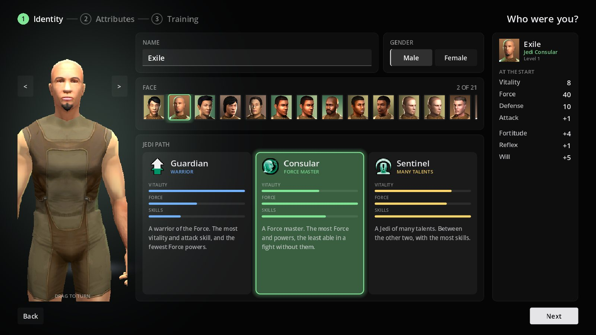
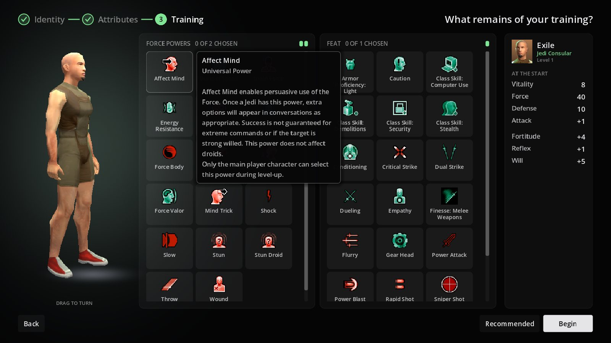
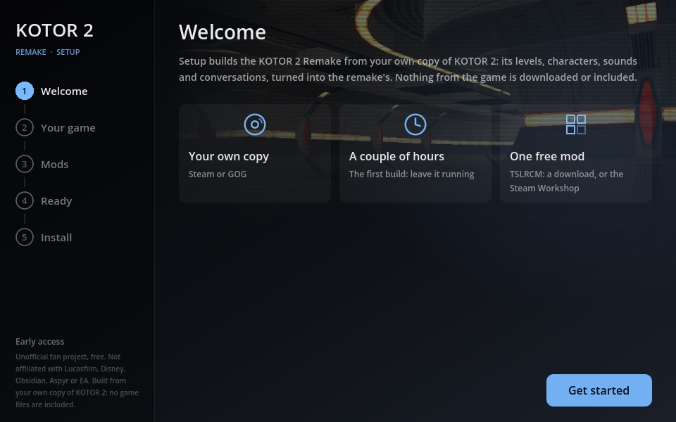
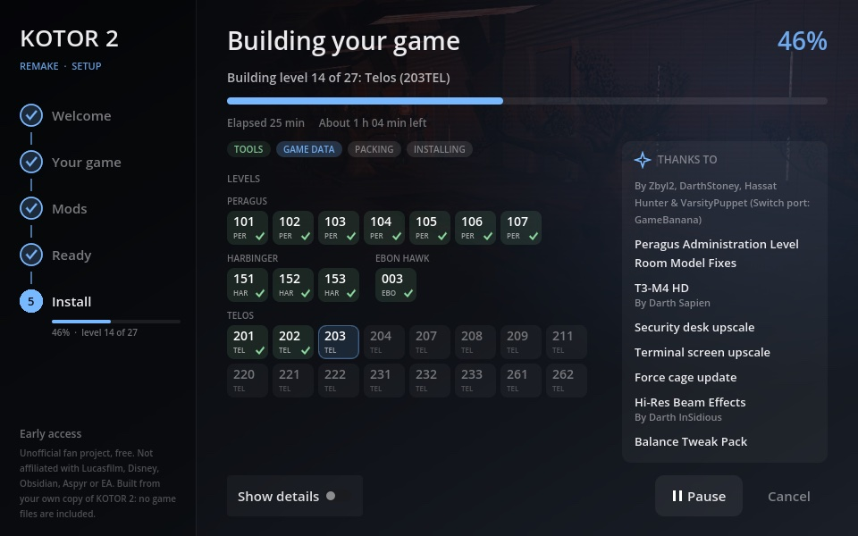

# KOTOR 2 Remake (fan project)

A fan remake of *Star Wars: Knights of the Old Republic II – The Sith Lords* in a modern engine. 
It runs the original game's own levels, conversations and scripts, built on your computer from **your own copy** of the game.

> [!WARNING]
> **Early access: the first level only.** Peragus and the Harbinger, start to finish, on Mac, Windows and Steam Deck.
> Things are expected to be broken.
> It's an engine recreation: the original game as it was, with only light modernization. See the
> [roadmap](RELEASE_CHECKLIST.md) for what's done and what's next.

> [!NOTE]
> **Unofficial and free.** Not affiliated with or endorsed by Lucasfilm, Disney, Obsidian, Aspyr or EA. This download
> contains **no files from the original game**: you need your own copy of KOTOR 2 (Steam or GOG).

---

## What it looks like

  

**Classic or Enhanced, your choice.** Classic looks exactly as the game always did. Enhanced adds light, glow and
richer effects: a lightsaber colours the walls and whoever holds it, blaster bolts streak and light their way, and
grenades go off with a flash, a fireball and smoke.

  

<table>
  <tr>
    <td width="50%"></td>
    <td width="50%"></td>
  </tr>
  <tr>
    <td align="center">Force powers</td>
    <td align="center">Grenades: frag, plasma, ion, cryoban and more, each with its own look</td>
  </tr>
</table>

**Make your Exile.** Choose your face, your Jedi path, your attributes and what's left of your training, and see what
it all comes to as you go. Each path has its own colour.

<table>
  <tr>
    <td width="50%"></td>
    <td width="50%"></td>
  </tr>
  <tr>
    <td align="center">Who were you?</td>
    <td align="center">What remains of your training?</td>
  </tr>
</table>

**Menus that explain themselves.** Your character, party, inventory, journal and map, laid out as cards. Point at any
number to see how it's made up.

  

**Setup does the work.** It finds KOTOR 2 in Steam or GOG, tells you about the one free download it needs, and builds
the game while you watch each level come together.

<table>
  <tr>
    <td width="33%"></td>
    <td width="33%"></td>
    <td width="33%"></td>
  </tr>
  <tr>
    <td align="center">Welcome</td>
    <td align="center">One download needed; the rest are optional upgrades</td>
    <td align="center">Watch it build, level by level</td>
  </tr>
</table>

Also in this demo: upscaling (MetalFX and FSR 2) for a sharper, smoother picture on a Mac, characters who turn to
whoever's talking, rooms that echo by their size, controller support, and mods you can switch on and off without a
restart.

Screenshots from the demo on a Mac, Effects set to Enhanced.

---

## Download

From [Releases](../../releases), get the Setup for your system:

| System | Download | Install guide |
|---|---|---|
| **Mac** (Apple Silicon, macOS 14 or later) | `KOTOR2-Remake-Setup.dmg` | [below](#install-on-a-mac) |
| **Windows** 10 or 11, 64-bit *(experimental)* | `KOTOR2-Remake-Setup-Windows.zip` | [INSTALL_WINDOWS.md](INSTALL_WINDOWS.md) |
| **Steam Deck** and Linux *(experimental)* | `KOTOR2-Remake-Setup-Linux.tar.gz` | [INSTALL_STEAM_DECK.md](INSTALL_STEAM_DECK.md) |

On every system you need your own copy of KOTOR 2 (Steam or GOG) and one free mod, TSLRCM. Setup builds the game from
your copy on your computer, so the first install takes a while. **Windows and Steam Deck are experimental**: they're new
and haven't been run on real hardware yet, so reports from them are especially welcome.

## Install on a Mac

1. **Have KOTOR 2** installed from Steam or GOG.
2. **Get TSLRCM** (free, required): subscribe on the [Steam Workshop](https://steamcommunity.com/sharedfiles/filedetails/?id=485537937),
   or download [TSLRCM 1.8.6 from GameBanana](https://gamebanana.com/mods/617353) into your Downloads folder. Setup
   finds either by itself, unpacks the download (the `.7z` too), and can use a copy saved anywhere else.
3. **Open the dmg and run KOTOR 2 Remake Setup.** It isn't signed by Apple, so the first time macOS says it can't
   check it: click **Done**, open **System Settings → Privacy & Security**, scroll down and click **Open Anyway** next
   to KOTOR 2 Remake Setup, then confirm. Setup walks you through a few short pages (your game, mods, then
   **Ready**, which checks everything at once, then **Install**). If something's missing, it says what and updates by
   itself once you've downloaded it.
4. **Wait.** The first build takes an hour or more, and Setup shows how long is left. If it stops, it says what to do,
   and **Try again** carries on where it stopped. When it's done, Setup removes everything it used to build the game.
   Then press **Play**.

On Windows or a Steam Deck, follow [INSTALL_WINDOWS.md](INSTALL_WINDOWS.md) or
[INSTALL_STEAM_DECK.md](INSTALL_STEAM_DECK.md): the same Setup, with the steps for that system (on the Deck, including
adding the game to Steam for Game Mode).

**Updating:** download the new Setup and run it. If your game data is still current, it says **Update** and only
replaces the game, in about a minute; your game data, mods, saves and settings stay as they are.

Why these mods, and what each one does: [COMMUNITY_MODS.md](COMMUNITY_MODS.md).

<table>
  <tr>
    <td width="50%"></td>
    <td width="50%"></td>
  </tr>
  <tr>
    <td width="50%"></td>
    <td width="50%"></td>
  </tr>
  <tr>
    <td width="50%"></td>
    <td width="50%"></td>
  </tr>
</table>

---

## Testing and bug reports

This is a test build: thank you for trying it. Before reporting, check the [known issues](KNOWN_ISSUES.md). Want to
help more? The [testing guide](TESTING.md) lists the parts that most need someone to play them.

The easiest way to report a problem is **Report a Bug**, on the title screen or the pause menu (Esc). Say what
happened and press **Open report on GitHub**: the build, the level and your computer are filled in for you, and
**Show files to attach** gathers the log and a screenshot. If the game crashes, the title screen offers to report it
next time you start it.

You can also open an [issue](../../issues/new/choose) by hand. The build number is at the bottom right of the title
screen.

## Mods

The remake has its own mod support: drop a mod's `.zip` into the `mods` folder beside the game and switch it on in
**Mods** on the title screen. Mods can change how the game plays (hard modes, Ironman, new items), not just how it
looks. Making mods: [MODDING.md](MODDING.md), with an example mod and the packing tools in [modding/](modding).

---

## Credits

| What | Who |
|---|---|
| **The original game** | BioWare and Obsidian Entertainment. Star Wars is Lucasfilm's. |
| **TSLRCM** | by Zbyl2, DarthStoney, Hassat Hunter & VarsityPuppet (Switch port on [GameBanana](https://gamebanana.com/mods/617353)). |
| **Optional mods, ported as examples** | Vanilla Planets HD and Vanilla Characters HD by Saul0097, Relighting TSL by J. Used without their authors' direct permission; nothing of theirs is included. Authors who'd like theirs left out can open an issue. Details: [COMMUNITY_MODS.md](COMMUNITY_MODS.md). |
| **Tools** | [Godot Engine](https://godotengine.org) (MIT), [Dialogue Manager](https://github.com/nathanhoad/godot_dialogue_manager) (MIT), [KotorBlender](https://github.com/OpenKotOR/kotorblender) (GPL-3.0), [PyKotor](https://github.com/NickHugi/PyKotor) (LGPL), [Blender](https://www.blender.org) (GPL). |
